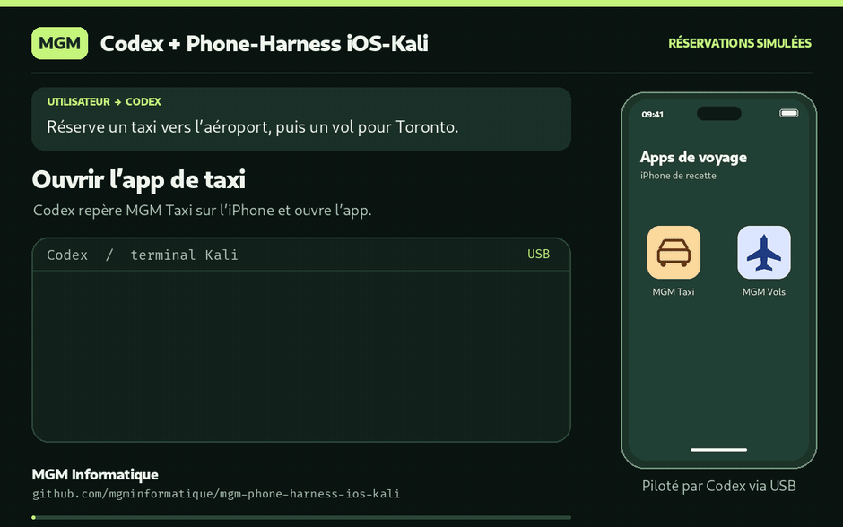

# MGM Phone-Harness iOS-Kali

[English](README.md) · **Français**

Observe et teste un iPhone branché en USB depuis Kali Linux. Codex peut lire l’écran, ouvrir une app de recette et exécuter une tâche avec l’accord de l’opérateur. Le même lanceur prépare, vérifie et installe les mises à jour IPA de MGM Agent Admin.

## Démo Codex

> Ouvre l’app de recette, active le mode démo et vérifie son état.

Codex ouvre l’app avec l’accord de l’opérateur, lit les libellés d’accessibilité, envoie un appui confirmé, puis vérifie le nouvel état. La démo de 23 secondes utilise un iPhone simulé.



[Télécharger la démo MP4 en français](https://github.com/mgminformatique/mgm-phone-harness-ios-kali/releases/download/v0.1.0/mgm-phone-harness-ios-kali-codex-fr.mp4)

## Démarrage

| Fonction | Prérequis |
| --- | --- |
| Diagnostic USB et installateur | Un iPhone jumelé au poste Kali et le service `usbmuxd`. |
| Capture, lecture et gestes | Un iPhone déverrouillé et un pilote de test XCTest WebDriverAgent déjà provisionné et démarré. |
| Visionneuse | Tk, Pillow, `go-ios` 1.3.2 et un tunnel développeur déjà ouvert sur la boucle locale. |

Installe Git, Rust 1.89 ou une version ultérieure et les dépendances Kali, puis compile l’installateur depuis les sources.

```bash
sudo apt install build-essential pkg-config libdbus-1-dev python3 usbmuxd
git clone https://github.com/mgminformatique/mgm-phone-harness-ios-kali.git
cd mgm-phone-harness-ios-kali
./mgm-ios-kali build
./mgm-ios-kali installer diagnose
```

```bash
./mgm-ios-kali installer --help
./mgm-ios-kali phone --help
```

Relève l’UDID dans le diagnostic puis définis `udid` dans le terminal. Toutes les opérations qui visent un iPhone demandent cet identifiant.

## Phone Harness

```bash
./mgm-ios-kali phone status --device "$udid"
./mgm-ios-kali phone capture ecran.png --device "$udid"
./mgm-ios-kali phone read --device "$udid"
```

Ces commandes utilisent `usbmuxd` et un pilote de test XCTest WebDriverAgent déjà provisionné et démarré sur l’iPhone. L’iPhone reste déverrouillé durant le test. `driver-required` indique que le pilote de test est indisponible. `installer diagnose` permet alors de vérifier la connexion USB indépendamment.

Les gestes se lancent un à la fois dans un terminal interactif. Ouvre l’image de référence avant de confirmer le geste. Les coordonnées partent du coin supérieur gauche et vont de 0 à 1. L’outil revérifie l’image, l’app active et la géométrie avant l’envoi. Si le résultat d’un geste est `unconfirmed`, vérifie son effet sur l’iPhone avant de refaire la commande.

```bash
./mgm-ios-kali phone tap 0.5 0.4 --device "$udid" --reference ecran.png
./mgm-ios-kali phone launch com.apple.Preferences --device "$udid" --reference ecran.png
```

La visionneuse en direct reprend le service de capture développeur Apple. Elle utilise Tk, Pillow, `go-ios` 1.3.2 et le port d’un tunnel utilisateur déjà ouvert sur la boucle locale pour cet iPhone. Les captures de la visionneuse restent dans un dossier temporaire nettoyé à la fermeture.

```bash
./mgm-ios-kali phone live --device "$udid" --ios "$go_ios" --tunnel-port "$tunnel_port"
```

## MGM iOS Installer

```bash
./mgm-ios-kali installer installed --device "$udid"
./mgm-ios-kali installer inspect "$ipa" --device "$udid"
./mgm-ios-kali installer preflight "$ipa" --device "$udid"
```

Le compagnon prépare les mises à jour MGM Agent Admin avec le compte développeur, la confirmation Apple et l’identité de l’application déjà installée. Pour signer une IPA MGM standard, indique ton origine Anisette dans `origine` et choisis un nouveau fichier de sortie.

```bash
./mgm-ios-kali installer prepare "$original" --device "$udid" --provider "$origine" --output "$signe"
./mgm-ios-kali installer inspect "$signe" --device "$udid"
./mgm-ios-kali installer preflight "$signe" --device "$udid"
```

La commande explicite `install` demande le SHA-256 de l’IPA imprimé par `inspect`. L’installateur conserve le journal natif MGM sous `${XDG_DATA_HOME:-$HOME/.local/share}/ca.mgminformatique.agent/ios-installer`. En cas d’issue incertaine, `receipts` puis `recover ID --device "$udid"` relisent l’état avant toute nouvelle installation.

## Vérification locale

Les tests couvrent les diagnostics USB et les gestes sur un iPhone simulé, ainsi que le prévol IPA, le transfert et la reprise après interruption. La partie Python utilise Python 3.10 ou une version ultérieure. Cargo résout les dépendances à partir du verrou fourni. Les dépendances en cache permettent de lancer les tests avec `--offline`.

```bash
./mgm-ios-kali test
```

L’exécutable compilé se trouve dans `installer/target/release/` par défaut. Le lanceur fonctionne depuis un autre dossier et accepte aussi le `CARGO_TARGET_DIR` configuré lors de la compilation.

## Provenance

MGM Informatique a développé le transport iOS USB pour Kali, la visionneuse et le compagnon MGM iOS Installer. L’intégration initiale utilisait Phone Harness 0.3.3. [Projet Phone Harness en amont](https://github.com/phone-harness/phone-harness)

Licences des composants utilisés dans le chantier d’origine et dans le compagnon de signature. [Licence de Phone Harness](phone-harness/LICENSE.upstream) · [Notices de l’installateur](installer/notices/README.fr.md)
