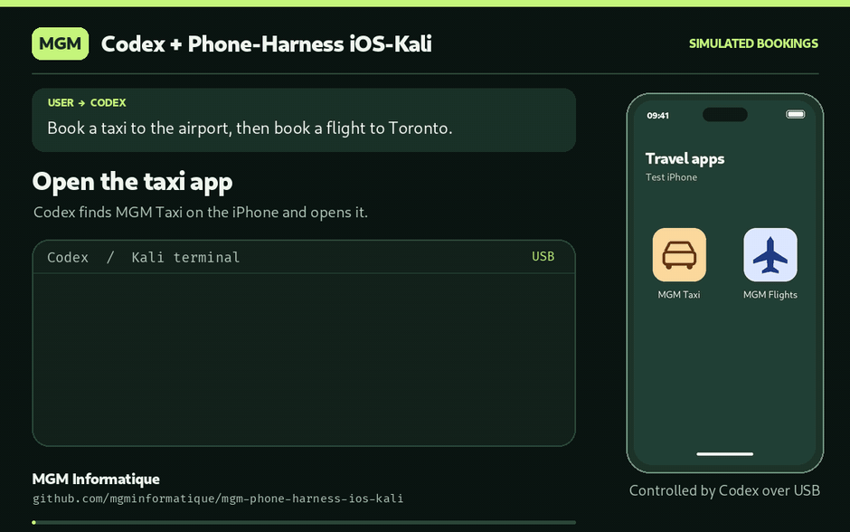

# MGM Phone-Harness iOS-Kali

**English** · [Français](README.fr.md)

Inspect and test an iPhone over USB from Kali Linux. Codex can read the screen, open a test app and carry out a task with the operator’s approval. The same launcher prepares, checks and installs MGM Agent Admin IPA updates.

## Codex demo

> Book a taxi to the airport, then book a flight to Toronto.

Watch Codex’s commands on the left and the iPhone screen on the right. Codex opens the taxi app, reviews the airport ride, then switches to the flight app and selects a nonstop flight to Toronto. The operator approves each action, and Codex reads both confirmations back from the phone. The 38-second demo uses a simulated iPhone and test bookings.



[Download the English MP4](https://github.com/mgminformatique/mgm-phone-harness-ios-kali/releases/download/v0.1.0/mgm-phone-harness-ios-kali-codex-travel-en.mp4)

## Getting started

| Feature | Requirements |
| --- | --- |
| USB diagnostics and installer | An iPhone paired with the Kali host and the `usbmuxd` service. |
| Screenshots, accessibility labels and gestures | An unlocked iPhone with a provisioned XCTest WebDriverAgent already running. |
| Live viewer | Tk, Pillow, `go-ios` 1.3.2 and an active developer tunnel on the loopback interface. |

Install Git, Rust 1.89 or later and the Kali dependencies, then build the installer from source.

```bash
sudo apt install build-essential pkg-config libdbus-1-dev python3 usbmuxd
git clone https://github.com/mgminformatique/mgm-phone-harness-ios-kali.git
cd mgm-phone-harness-ios-kali
./mgm-ios-kali build
./mgm-ios-kali installer diagnose
```

```bash
./mgm-ios-kali installer --help
./mgm-ios-kali phone --help
```

Set the `udid` shell variable to the iPhone’s UDID shown in the USB diagnostics. Every command that targets an iPhone requires this identifier.

## Phone Harness

```bash
./mgm-ios-kali phone status --device "$udid"
./mgm-ios-kali phone capture screen.png --device "$udid"
./mgm-ios-kali phone read --device "$udid"
```

Keep the iPhone unlocked during the test. `driver-required` means the test driver is unavailable. Use `installer diagnose` to check the USB connection on its own.

Run each gesture in an interactive terminal. Open the reference screenshot and enter `o` or `oui` at the confirmation prompt. Coordinates run from 0 to 1, starting at the top-left corner. The launcher rechecks the screenshot, foreground app and screen dimensions before sending the gesture. If the result is `unconfirmed`, check the iPhone before retrying.

```bash
./mgm-ios-kali phone tap 0.5 0.4 --device "$udid" --reference screen.png
./mgm-ios-kali phone launch com.apple.Preferences --device "$udid" --reference screen.png
```

The live viewer uses Apple’s developer screenshot service. Set `go_ios` to the `go-ios` executable and `tunnel_port` to the port of the iPhone’s existing loopback tunnel. The viewer removes its temporary screenshots when it closes.

```bash
./mgm-ios-kali phone live --device "$udid" --ios "$go_ios" --tunnel-port "$tunnel_port"
```

## MGM iOS Installer

```bash
./mgm-ios-kali installer installed --device "$udid"
./mgm-ios-kali installer inspect "$ipa" --device "$udid"
./mgm-ios-kali installer preflight "$ipa" --device "$udid"
```

The installer prepares MGM Agent Admin updates using a developer account, Apple verification and the signing identity of the installed app. To sign a standard MGM IPA, set `origin` to your Anisette server origin and choose a new output file.

```bash
./mgm-ios-kali installer prepare "$original" --device "$udid" --provider "$origin" --output "$signed"
./mgm-ios-kali installer inspect "$signed" --device "$udid"
./mgm-ios-kali installer preflight "$signed" --device "$udid"
```

The `install` command requires the IPA’s SHA-256 digest from `inspect`. The installer stores its journal in `${XDG_DATA_HOME:-$HOME/.local/share}/ca.mgminformatique.agent/ios-installer`. If the outcome is uncertain, use `receipts` and then `recover ID --device "$udid"` to check the result before starting another installation.

## Local testing

Tests cover USB diagnostics and gestures on a simulated iPhone, as well as IPA preflight, transfer and recovery. The Python tools require Python 3.10 or later. Cargo uses the supplied lockfile. Pass `--offline` when the dependencies are already cached.

```bash
./mgm-ios-kali test
```

By default, the executable is built into `installer/target/release/`. The launcher works from any directory and uses the `CARGO_TARGET_DIR` configured at build time when set.

## Credits

MGM Informatique developed the Kali USB transport, live viewer and MGM iOS Installer. The original integration used Phone Harness 0.3.3. [Upstream Phone Harness project](https://github.com/phone-harness/phone-harness)

Licenses and notices for the upstream project and installer dependencies. [Phone Harness license](phone-harness/LICENSE.upstream) · [Installer notices](installer/notices/README.md)
